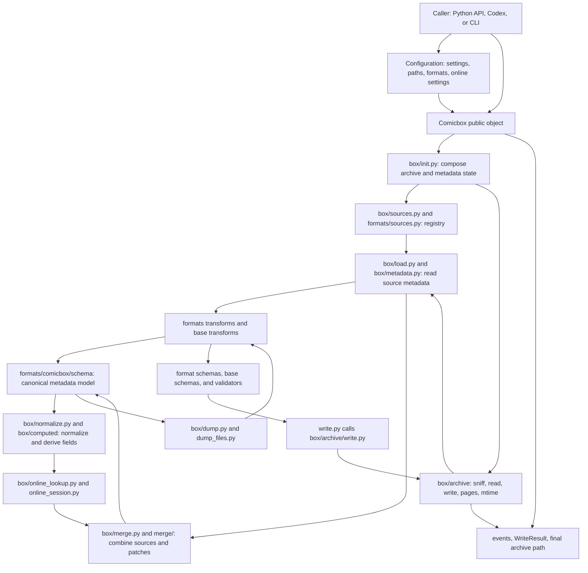
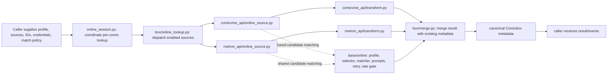
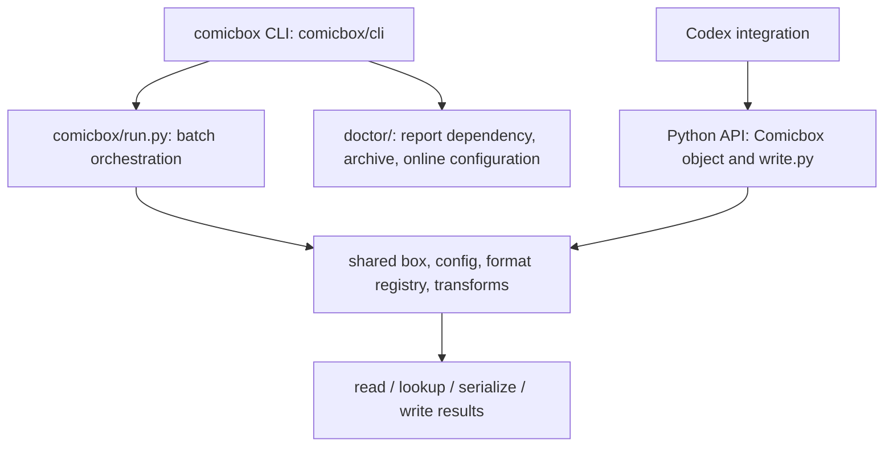

# Comicbox Architecture and Workflows

**Repository snapshot:** local `../comicbox`, `main`, `9cacf3c` (`v5.6.1`, 2026-11-06), clean and tracking `origin/main` when scanned on 2026-11-09.
**Purpose:** Module-level map for understanding how the Comicbox API and CLI read, normalize, fetch, merge, transform, validate, and write comic metadata.

These diagrams summarize source organization, not every function call. The
repository changes over time; use the paths and commit above when comparing
this map with a different checkout.

## 1. Main architecture



## 2. Read/import workflow

```mermaid
sequenceDiagram
    participant Caller as Python API / Codex / CLI
    participant Box as Comicbox
    participant Registry as format/source registry
    participant Archive as archive reader
    participant Transform as format transform
    participant Canonical as Comicbox canonical schema
    participant Compute as normalization/computed fields

    Caller->>Box: Comicbox(path, config, metadata?)
    Box->>Registry: resolve archive and enabled metadata formats
    Box->>Archive: sniff file, enumerate archive entries
    Archive-->>Box: images and embedded metadata files
    loop each readable metadata source
        Box->>Transform: parse source schema and transform to canonical keys
        Transform->>Canonical: validate/normalize field representation
        Canonical-->>Box: source metadata dict
    end
    Box->>Box: merge source dictionaries under configured read policy
    Box->>Compute: derive IDs, dates, issue parts, pages, URLs, notes, etc.
    Compute-->>Box: normalized canonical metadata
    Box-->>Caller: properties / to_dict() / to_string(format)
```

The format registry and transforms separate each container's vocabulary from
the canonical Comicbox representation. Relevant format directories include
`comic_info`, `metron_info`, `comet`, `comic_book_info`, `pdf`, `filename`,
`comicvine_api`, and `metron_api`.

## 3. Online lookup and enrichment



Comic Vine and Metron have source-specific clients and payload transforms;
shared online modules handle matching, selection/prompting, credentials,
retry, throttling/rate limits, series filtering/cache, and session state. The
Metron API transform can preserve a GCD cross-identifier when that identifier
is present in Metron's issue payload. The inspected tree has no GCD API source
adapter; a local GCD dataset would need its own intake and adapter to canonical
metadata.

## 4. Write workflow

```mermaid
sequenceDiagram
    participant Caller as Caller
    participant API as Public write API
    participant Box as Comicbox object
    participant Merge as Merge and delete paths
    participant Transform as Format transform
    participant Validate as Schema validation
    participant Archive as Archive writer
    participant Result as Write result and events

    Caller->>API: Path, canonical patch, formats, merge mode
    Note over Caller,API: Optional delete paths and dry-run flag
    API->>Box: Load archive and existing metadata
    Box->>Merge: Merge patch and apply explicit deletions
    Merge-->>Box: Final canonical metadata
    loop Each selected format
        Box->>Transform: Serialize canonical fields for format
        Transform->>Validate: Validate generated representation
        Validate-->>Transform: Valid result or validation error
    end
    alt Dry run
        Transform-->>API: Serialized preview, archive stays untouched
    else Write
        API->>Archive: Replace metadata members and repack
        Archive-->>API: Final path, possibly converted to CBZ
    end
    API-->>Result: Per-file status, error, preview, and final path
    Result-->>Caller: Result and lifecycle events
```

Important write concepts: canonical patches; target format selection;
`additive`, `replace`, or `update` merge modes; explicit `delete_keys` for
clears; dry-run serialization; per-item errors; and a possible final-path
change when an archive format is converted to CBZ. Callers that track files
must use the result's final path and handle the configured original-retention
policy.

## 5. CLI and public API entry points



Codex is an external caller/orchestrator. Its own task queues, permissions,
database bookkeeping, re-import, and UI are not Comicbox modules; Comicbox
provides the reusable metadata/archive library underneath those workflows.

## 6. Directory map by responsibility

| Package area | Responsibility |
|---|---|
| `comicbox/box/` | Public object composition, source loading, metadata normalization, computed fields, merging, dumping, online lookup, archive I/O. |
| `comicbox/formats/` | Format registry, source adapters, schemas, and transformations between external formats and canonical metadata. |
| `comicbox/formats/base/` | Shared field/schema/transform machinery and online matching/network policies. |
| `comicbox/config/` | Typed configuration, defaults, path resolution, online settings, and derived configuration. |
| `comicbox/merge/` | Merge algorithms and field-level conflict policy. |
| `comicbox/validate/` and `comicbox/formats/base/schemas/` | JSON/XML/YAML schema validation and error reporting. |
| `comicbox/cli/`, `comicbox/run.py` | Command-line interface and multi-file orchestration. |
| `comicbox/doctor/` | Diagnostics for packages, archives, images, settings, and online sources. |
| `comicbox/identifiers/`, `comicbox/enums/` | Identifier parsing/URLs and normalized vocabularies. |
| `tests/` | Format, API, online behavior, archive handling, validation, and regression fixtures. |

## 7. Local-GCD integration implications

1. Keep the GCD snapshot importer separate from archive writing; record its
   provenance, schema/version, date, and applicable data-use terms.
2. Resolve candidate comic matches first, with identifiers and other evidence
   shown to a reviewer; do not silently equate a title/issue guess with a
   confirmed record.
3. Convert approved GCD fields into Comicbox's canonical schema, not directly
   into format-specific XML.
4. Use dry-run output and validate the selected target formats before writes.
5. Preserve existing metadata unless field precedence explicitly authorizes
   replacement; choose merge mode and deletion paths deliberately.
6. Exercise both XML formats, dual-format archives, malformed/duplicate
   members, unsupported formats, interrupted writes, and conversion/final-path
   handling on disposable fixtures before any library batch.

This document is a source-derived architecture map. It does not claim runtime
validation, current external API availability, or approval of GCD data use.
